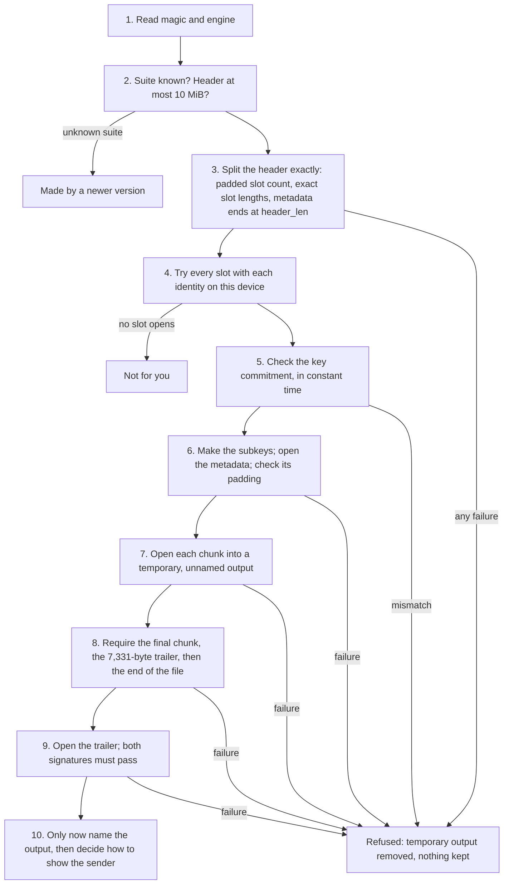

## Overview

**What Doughnut Forge protects.** Doughnut Forge encrypts files, folders and short notes so that only the people they are meant for can open them. It runs on Android, iPhone and iPad, Mac and Windows. It has no servers, no accounts and no cloud storage. Keys are made on the device, files are encrypted on the device, and nothing leaves the device unless the person shares it.

**How.** Each person has one identity: a secret made of 32 random bytes, written down as 24 recovery words. All of that person's keys are made from it. When a file is encrypted, it is locked with a fresh key of its own, and that key is then locked separately for each person who may open it. Each of those locks uses two methods at once: one long trusted, and one designed to resist attacks by future quantum computers, using NIST-standardised post-quantum algorithms alongside classical ones. (NIST is the US National Institute of Standards and Technology.) An attacker would have to break both. Every v3 file is also signed twice by the person who made it, again with one classical and one post-quantum method, and the signatures cover the whole file. On the device, the identity is kept locked under the person's password, stretched with a deliberately slow and memory-hungry function so that guessing passwords is expensive.

**What a person sees.** The app names a contact as the sender only when the file is signed with the keys on that contact's new card. Otherwise it shows that the sender is unknown. The name is only as reliable as the card: compare the contact code.

**What it does not protect against.**

- A device that is already compromised (malware, or someone with control of the device while the app is unlocked).
- Anyone who has the 24 recovery words, enough recovery shards, or the password together with the device.
- What recipients do with a file once they have opened it. Recipients can also show others who signed a file.
- What can be seen from outside a file: its size, its name on disk, its dates, where it is kept and how it is sent.
- A lost password when the recovery words and shards are lost too. There is no server and no other way back.
- Weaknesses in the algorithms that nobody has found yet. Using two methods at once limits the damage if one is broken; it cannot rule out flaws in both.

**What is new in crypto format v3.** v3 is a new file format, a new contact card, a new contact code and a new way of storing the identity under a password. It adds ML-KEM-1024 and ML-DSA-87 (the strongest NIST post-quantum settings) to every identity. Every file made by any earlier version keeps opening.

**About this paper.** It describes the app as built for the release that introduces crypto format v3, as it stood on 14 November 2026. Doughnut Forge has not had an outside security audit. Each section opens with a short summary in plain words, then gives the full technical detail, and ends with "How this is checked": what was tested, and how. A glossary is at the end.

---

## 1. Design principles

**In short.** Doughnut Forge works entirely on the device, makes every key from one secret, and always uses a classical and a post-quantum method together. It is built from published, widely used standards, and refuses anything that does not match its format exactly.

1. **Offline, always.** The app makes no network connections of its own: no account, no sign-in, no analytics, no crash reports, no update checks. There is no server that could hold keys, see who talks to whom, or be forced to hand anything over.
2. **One identity, from one secret.** A person's identity is one 256-bit random secret, called the seed. Every private key is made from it, so the 24 recovery words bring back everything, on any device.
3. **Hybrid by default.** "Hybrid" means two methods used together. Every key exchange (the step that lets a recipient, and only that recipient, recover a file's key) uses a classical algorithm and a post-quantum algorithm together, and every v3 signature is made twice, once with each kind. An attacker has to break both.
4. **Standard parts, no new primitives.** A primitive is a basic cryptographic building block, such as a cipher. Doughnut Forge uses AES-256-GCM, X25519, Ed25519, ML-KEM (FIPS 203), ML-DSA (FIPS 204), SHA-2, HKDF and Argon2id, from maintained open-source Rust libraries. It combines them; it does not invent ciphers.
5. **One key per job.** Every key is used for one purpose, kept apart from every other by its own label in HKDF (a standard function that turns one secret into several independent keys).
6. **Refuse, do not guess.** A file, card or identity that does not match the format exactly is refused. Nothing is shown, named or kept from a file until every check has passed.
7. **Old files open for ever.** Every format the app has ever written stays readable. New keys are added beside the old ones; no existing key, identity name or recovery word ever changes.
8. **The engine checks everything itself.** The app's core, written in Rust, never trusts what the app's screens send: it reads the stored identity itself and checks every path, key and signature.

<details class="checked">
<summary>How this is checked</summary>

The Android release build is checked automatically to make sure it does not include the permission to use the internet, and the app's content policy does not allow its screens to load anything from the internet. Automated tests check that the unlock commands take no identity from the screens and read the stored one instead. Each of the other principles is checked in the section that describes it.

</details>

---

## 2. Keys from the recovery words

**In short.** A person's identity is one secret of 32 random bytes. The 24 recovery words are that same secret written as words, so they bring back every key. v3 adds two new keys made from the same secret, so nobody needs a new backup and nothing that exists today changes.

### 2.1 The seed

An identity is one 32-byte seed drawn from the operating system's secure random source when the identity is created. The 24 recovery words are that seed written in the BIP-39 word list (a published standard list of 2,048 words): the words encode the seed itself, with BIP-39's checksum, so restoring from the words gives back the exact same 32 bytes.

The seed is never stored in the clear. On the device it is kept only inside the identity blob, sealed under the person's password (section 5). While the app is unlocked it is held in locked, guarded memory (provided by the libsodium library) and is wiped when the app locks.

### 2.2 What is made from the seed

<figure class="diagram">
<svg viewBox="0 0 640 458" role="img" aria-labelledby="keys-title">
<title id="keys-title">Every key is made from the seed, and the seed is the 24 recovery words</title>
<g fill="none" stroke="#94a3b8" stroke-width="2">
<rect x="20" y="10" width="220" height="40" rx="10"/>
<rect x="20" y="90" width="220" height="40" rx="10"/>
<path d="M130 50v40"/>
<path d="M130 130V166h215"/><rect x="345" y="150" width="280" height="32" rx="8"/>
<path d="M130 130V210h215"/><rect x="345" y="194" width="280" height="32" rx="8"/>
<path d="M130 130V254h215"/><rect x="345" y="238" width="280" height="32" rx="8"/>
<path d="M130 130V298h215"/><rect x="345" y="282" width="280" height="32" rx="8"/>
<path d="M130 130V342h215"/><rect x="345" y="326" width="280" height="32" rx="8"/>
<path d="M130 130V386h215"/><rect x="345" y="370" width="280" height="32" rx="8"/>
<path d="M130 130V430h215"/><rect x="345" y="414" width="280" height="32" rx="8"/>
</g><g font-size="14" fill="#334155">
<text x="130" y="35" text-anchor="middle">24 recovery words</text>
<text x="140" y="74">BIP-39: the same 32 bytes</text>
<text x="130" y="115" text-anchor="middle">Seed (32 bytes)</text>
<text x="140" y="162" font-size="12" fill="#64748b">used directly</text><text x="355" y="171">X25519 key pair</text>
<text x="140" y="206" font-size="12" fill="#64748b">used directly</text><text x="355" y="215">Ed25519 signing key</text>
<text x="140" y="250" font-size="12" fill="#64748b">HKDF, label: ml-kem-768 seed</text><text x="355" y="259">ML-KEM-768 key pair</text>
<text x="140" y="294" font-size="12" fill="#64748b">HKDF, label: v3 ml-kem-1024 seed</text><text x="355" y="303">ML-KEM-1024 key pair (new in v3)</text>
<text x="140" y="338" font-size="12" fill="#64748b">HKDF, label: v3 ml-dsa-87 seed</text><text x="355" y="347">ML-DSA-87 key pair (new in v3)</text>
<text x="140" y="382" font-size="12" fill="#64748b">HKDF, label: contact-store v1</text><text x="355" y="391">Contact-store key</text>
<text x="140" y="426" font-size="12" fill="#64748b">HKDF, label: contact-store id v1</text><text x="355" y="435">Contact-store file name</text>
</g></svg>
<figcaption>The X25519 key and the ML-KEM-768 key together make the DID, the identity&#39;s public name.</figcaption></figure>

| Key | How it is made | Since | Changes in v3? |
|---|---|---|---|
| X25519 key pair | The seed used directly as the X25519 secret | first release | No |
| Ed25519 signing key | The seed used directly as the Ed25519 secret (RFC 8032) | first release | No |
| ML-KEM-768 key pair | HKDF-SHA256 (no salt, the seed, label `doughnut-forge ml-kem-768 seed`) to 64 bytes, used as the FIPS 203 seed (d, then z) | first release | No |
| DID | `did:forge:z` + base58 of (0x12 0x01, X25519 public key, ML-KEM-768 public key) | first release | No |
| Contact-store key | HKDF-SHA256 (no salt, the seed, label `doughnut-forge contact-store v1`) | 0.4.x | No |
| Contact-store file name | 8 bytes of HKDF-SHA256 (no salt, the seed, label `doughnut-forge contact-store id v1`) | 0.4.x | No |
| **ML-KEM-1024 key pair** | HKDF-SHA256 (no salt, the seed, label `doughnut-forge v3 ml-kem-1024 seed`) to 64 bytes, used as the FIPS 203 seed (d, then z) | **v3** | New |
| **ML-DSA-87 key pair** | HKDF-SHA256 (no salt, the seed, label `doughnut-forge v3 ml-dsa-87 seed`) to 32 bytes, used as the FIPS 204 seed (ξ) | **v3** | New |

A DID (decentralised identifier) is the identity's public name: a string anyone can hold that names the person's public keys. A key pair is a private key, kept secret, and its public key, which can be shared.

### 2.3 What this means

- **Nothing existing changes.** The first six rows are byte for byte what every released version does.
- **Nobody makes a new backup.** The new ML-KEM-1024 and ML-DSA-87 keys come from the same seed through labels of their own, so the recovery words people already have restore them.
- **The new labels are used once.** Each new label appears exactly once in the app and differs from every other label.
- **Fixed for ever.** The two new labels, the 64-byte ML-KEM seed form, the 32-byte ML-DSA seed form and hedged ML-DSA signing (section 3.4) cannot change once v3 ships, because changing them would change every identity's keys.
- **DIDs do not change.** A DID still names the X25519 and ML-KEM-768 public keys only. The new keys travel on the v2 contact card (section 6), not in the DID.

<details class="checked">
<summary>How this is checked</summary>

Test identities made by earlier releases are kept as frozen files, and automated tests check that every existing key and DID made from them is still exactly the same. The two new keys are pinned to fixed expected values. A second, independent implementation of ML-KEM and ML-DSA (used only for testing, never in the app) makes the new keys from the same seeds on its own, and must get identical keys. A test also reads the app's code to check that each new label is used exactly once and differs from every other label.

</details>

---

## 3. Algorithms, and why each was chosen

**In short.** Files are locked with AES-256, the most widely used modern cipher. The key to each file is protected with two key exchanges at once, X25519 and ML-KEM-1024, and every file is signed with two signatures at once, Ed25519 and ML-DSA-87; in each pair, one is classical and one is post-quantum. Passwords are stretched with Argon2id, which makes every guess cost time and memory.

| Job | Algorithm | Parameters |
|---|---|---|
| Encrypting content, metadata, key slots, the trailer and the identity | AES-256-GCM | 256-bit key, 96-bit nonce, 128-bit tag |
| Key exchange to a recipient | X25519 + ML-KEM-1024 (ML-KEM-768 for contacts known by an old card) | NIST category 5 (category 3 for ML-KEM-768) |
| Signatures on files and cards | Ed25519 + ML-DSA-87, both required | NIST category 5 for ML-DSA-87 |
| Password to key | Argon2id | 256 MiB, 3 passes, 1 lane (new identities) |
| Key derivation and labelling | HKDF-SHA256 | RFC 5869 |
| Hashes | SHA-512 (header hash, content transcript), SHA-256 (inside HKDF, the slot binding, contact codes) | |

NIST's security categories run from 1 to 5; category 5 is the highest, comparable in strength to AES-256.

### 3.1 AES-256-GCM

AES-GCM is the most widely implemented cipher of its kind, fast on every platform the app runs on, and it checks its own output: every encrypted message carries a 16-byte tag, and any change to the encrypted bytes or to the extra data bound to them (the associated data) makes decryption fail. The 256-bit key leaves a wide margin, including against a quantum computer running Grover's search, the best known quantum attack on ciphers like AES.

AES-GCM has two known weak points, and v3 closes both by design:

- **A repeated nonce is fatal.** A nonce is a "number used once": a value that must never repeat under the same key. In v3 every key that uses a fixed nonce encrypts exactly one message (each key slot, the metadata, the trailer, the identity blob), and the chunk key uses a 64-bit counter that refuses to wrap round (section 4.6).
- **AES-GCM does not commit to its key.** One ciphertext can be built to decrypt under two different keys. v3 stores a commitment to the file's key in the header, inside the signed part, and the reader checks it before trusting anything decrypted (section 4.5).

### 3.2 X25519 + ML-KEM-1024 (and ML-KEM-768)

Each recipient's copy of the file's key is protected by two key exchanges at once: X25519 (elliptic-curve Diffie-Hellman, well studied and widely deployed) and ML-KEM (the lattice-based key encapsulation mechanism NIST standardised in FIPS 203). The two shared secrets are combined so that the result is designed to stay secret as long as either one stays secure (section 4.4). X25519 protects against a flaw found later in a young post-quantum algorithm; ML-KEM protects against a future quantum computer able to break X25519.

v3 uses **ML-KEM-1024** (NIST security category 5) for every identity. **ML-KEM-768** (category 3) stays in use for one case only: sending to a contact the app knows only from an old (v1) card, whose ML-KEM-1024 key it does not have. That contact's ML-KEM-768 key comes from their DID. Once they share a v2 card, files to them use ML-KEM-1024.

### 3.3 Ed25519 + ML-DSA-87

Every v3 file and every v2 contact card carries two signatures over the same message: Ed25519 (RFC 8032) and ML-DSA-87 (FIPS 204, NIST category 5). Both must pass; if either fails, the file or card is refused. A forger therefore has to break both a classical and a post-quantum scheme. v3 uses ML-KEM-1024 and ML-DSA-87, the strengths named in CNSA 2.0.

- Ed25519 signatures are checked in strict mode, which refuses signatures written in a non-standard form and public keys of small order (weak keys that can make a signature pass for more than one message).
- ML-DSA-87 signs and checks with a context string of its own for each use (`doughnut-forge v3 package`, `doughnut-forge card v2`), so a signature made for one purpose cannot be reused for another.

### 3.4 Hedged ML-DSA signing

ML-DSA can sign deterministically, or "hedged", mixing 32 fresh random bytes into each signature. v3 always signs hedged, with the random bytes drawn from the app's one randomness source (section 10), never from a library's own generator. Hedged signing is the FIPS 204 default and makes fault and side-channel attacks on signing harder. Ed25519 signing is deterministic, as RFC 8032 defines it.

### 3.5 Argon2id

The password that protects the identity is stretched with Argon2id (RFC 9106), the memory-hard function that won the Password Hashing Competition. Memory-hard means each password guess needs a large block of memory, which limits how much faster specialised hardware can guess. New identities use **256 MiB of memory, 3 passes and 1 lane**, with a fresh 16-byte salt (a random value that makes each stored identity's key different, even for the same password) and a 32-byte output (section 5). The setting was chosen for strength over speed, and measured on the Mac, the Android emulator and the iOS Simulator (section 9.6).

### 3.6 SHA-256, SHA-512 and HKDF

A hash function turns any input into a short, fixed-length fingerprint; changing any input byte changes the fingerprint completely.

- **HKDF-SHA256** turns one secret into several independent keys, each tied to its own label. v3 uses it for the new identity keys, the file's subkeys, the commitment and each slot's wrap key.
- **SHA-512** hashes the whole header (`H_hdr`) and the stream of encrypted chunks (the transcript `T`), which the signatures cover. Its 64-byte output gives a wide collision margin.
- **SHA-256** hashes the recipient's ML-KEM public key and ciphertext inside the slot binding, and makes contact codes.

### 3.7 A note on the libraries

The post-quantum code comes from the RustCrypto `ml-kem` and `ml-dsa` libraries. `ml-dsa` is young (version 0.1.x). For that reason both are checked against NIST's own test data and against a second, independent implementation (libcrux) on every test platform (section 11). libcrux is used only in tests and never ships in the app.

<details class="checked">
<summary>How this is checked</summary>

ML-KEM-768, ML-KEM-1024 and ML-DSA-87 are checked against NIST's published test data: key generation, encapsulation and decapsulation, signing and signature checking must all give NIST's exact answers. They are also cross-checked against libcrux, a second, independent implementation: for 3 fixed and 200 fresh random seeds, both must give identical keys, ciphertexts, shared secrets and signatures, and each must accept the other's output. Automated tests check that Ed25519 signatures in non-standard form are refused, that an ML-DSA-87 signature made without its context string is refused, and that two signatures of the same message differ (because signing is hedged) while both pass.

</details>

---

## 4. The v3 file format

**In short.** A v3 file has four parts: a short opening, a header that holds the locked copies of the file's key, the encrypted content in pieces, and a closing block with the signatures. Every part is tied to every other part, so a piece cannot be changed, moved, removed or borrowed from another file without the file being refused. The header is padded so it does not show how many people the file is for or how long its name is.

A v3 file (called a package below) is one file or, for a short note, the same bytes as Base64 text. It keeps the `VLT2` magic (the four bytes that mark the file type) and the `.vlt2` extension, so the file registrations on every platform stay as they are, and says "engine 3" in its preamble.

```
+--------------------------------------------------------------+
| Part A  preamble      12 bytes                               |
|         "VLT2", engine 3, suite 1, header length             |
+--------------------------------------------------------------+
| Part B  header                                               |
|         file salt                                            |
|         slot count (padded)                                  |
|         key slots, one per person, plus dummies, shuffled    |
|         key commitment                                       |
|         sealed metadata (name, type, padded)                 |
+--------------------------------------------------------------+
| Part C  chunks        the content, compressed, encrypted,    |
|                       up to 1 MiB each, the last one final   |
+--------------------------------------------------------------+
| Part D  trailer       7,331 bytes: the sealed signer block   |
|                       (public keys and both signatures)      |
+--------------------------------------------------------------+
  end of file: nothing may follow
```

Integers are little-endian unless marked BE (big-endian). `||` means joined.

### 4.1 Part A: preamble (12 bytes)

| Offset | Size | Field | Value |
|---|---|---|---|
| 0 | 4 | magic | `VLT2` |
| 4 | 2 | engine | 3 |
| 6 | 2 | suite | 1 |
| 8 | 4 | header_len | length of Part B, at most 10 MiB |

**Suite 1** is: key slots X25519 + ML-KEM-1024 (kind 2) or X25519 + ML-KEM-768 (kind 1), AES-256-GCM, HKDF-SHA256, a SHA-512 header hash and transcript, and Ed25519 + ML-DSA-87 signatures. The reader accepts only suites it knows (today, suite 1) and reports any other as "made by a newer version", before it tries any key. A later suite (for example a backup key exchange) can be added without another engine version.

### 4.2 Part B: header

| Size | Field | Notes |
|---|---|---|
| 32 | file_salt | fresh random; the salt for every HKDF below |
| 2 | slot_count | a padded count (section 4.3), 4 to 1,024 |
| slot_count × 1,169 or 1,649 | slots | shuffled; see 4.4 |
| 32 | commitment | HKDF(package key, file_salt, `doughnut-forge v3 commit`) |
| 4 | meta_len | length of the sealed metadata |
| meta_len | meta_ct | AES-256-GCM(K_meta, nonce of 12 zero bytes, padded metadata) |

The metadata is sealed with the whole of Part A and Part B up to and including the commitment as its associated data, so a changed salt, slot, count or commitment makes it fail to open.

The metadata itself is a small JSON object: the original name, its extension, its media type, an icon name and whether it is a file, folder or note. There is no stored ID: the progress ID the app uses while working is a separate random value kept in memory only.

### 4.3 Padding: slot count and metadata

v3 hides how many people can open a package and roughly how long the file's name is behind fixed steps.

**Slot count.** The number of slots is rounded up to 4, 8, 16, 32 or 64, then to the next multiple of 64, at most 1,024. The extra slots are dummies: kind 2 slots sealed by the same code to a throwaway ML-KEM-1024 and X25519 key pair made from fresh randomness, each wrapping 32 random bytes. They are the same size as real kind 2 slots and are designed to look like them. The reader tries every slot; a dummy never opens. The slots, real and dummy, are then shuffled with a Fisher-Yates shuffle that rejects draws which would bias it, so every order is equally likely and a slot's position says nothing. The reader refuses a slot count that is not one of the padded counts.

**Metadata.** The metadata JSON is followed by one 0x80 byte and zero bytes, up to the smallest of 512, 1,024, 2,048, ... bytes that fits (at most 8 MiB). The reader refuses any other padding.

What padding does not hide: the slot kind byte is in the clear, so a kind 1 slot shows that at least one recipient is known only by an old card (not who). See section 8.3.

### 4.4 Key slots

Each recipient, and the sender, gets one slot holding the package key (also called the DEK, the data encryption key: 32 random bytes) wrapped for them. A person listed twice gets one slot.

| Size | Field |
|---|---|
| 1 | kind: 1 = X25519 + ML-KEM-768; 2 = X25519 + ML-KEM-1024 |
| 32 | ephemeral X25519 public key (fresh for each slot) |
| 1,088 (kind 1) or 1,568 (kind 2) | ML-KEM ciphertext |
| 48 | wrapped package key: 32 bytes + 16-byte tag |

A slot is 1,169 bytes (kind 1) or 1,649 bytes (kind 2). The sender's own slot is always kind 2. "Ephemeral" means made fresh for this one use and then thrown away.

**The combiner.** For each slot:

```
x_ss     = X25519(ephemeral secret, recipient X25519 public key)    refused if all zero
k_ss     = ML-KEM.Encaps(recipient ML-KEM public key, m)            m: 32 fresh random bytes
wrap_key = HKDF-SHA256(
             salt = file_salt,
             ikm  = k_ss || x_ss,
             info = "doughnut-forge v3 slot" || kind
                    || ephemeral X25519 public key || recipient X25519 public key
                    || SHA-256(recipient ML-KEM public key) || SHA-256(ML-KEM ciphertext))
wrapped  = AES-256-GCM(wrap_key, 12 zero bytes, package key,
                       AAD = "VLT2" || engine || suite || file_salt || kind)
```

- The design follows X-Wing and the IETF generic hybrid combiner: the wrap key depends on both shared secrets and is bound to both X25519 public keys, the ML-KEM public key and its ciphertext, so it is designed to stay secret if either X25519 or ML-KEM stays secure.
- An all-zero (low-order) X25519 result is refused, on sealing and on opening.
- The recipient's ML-KEM public key must pass FIPS 203's input check before anything is sealed to it.
- A fixed zero nonce is safe here because each wrap key encrypts exactly one message.
- The file salt in the HKDF and in the associated data binds the slot to this package: a slot copied into another package does not open.

### 4.5 Package keys and the key commitment

The package key itself never encrypts anything. Four values are made from it, each with HKDF-SHA256 (salt = file_salt, input = the package key) and its own label:

| Label | Size | Use |
|---|---|---|
| `doughnut-forge v3 commit` | 32 | the key commitment, stored in the header |
| `doughnut-forge v3 meta` | 32 | K_meta: seals the metadata (one message, zero nonce) |
| `doughnut-forge v3 chunk` | 32 | K_chunk: seals every chunk (counter nonces) |
| `doughnut-forge v3 trailer` | 32 | K_trailer: seals the signer block (one message, zero nonce) |

**Why a commitment.** The commitment stops a sender from building one package whose slots give different recipients different package keys, so that each sees different content under the same signatures. The reader compares the stored commitment with the one it computes from the key it opened, in constant time (taking the same time whatever the bytes, so the timing reveals nothing), before it opens anything else; a mismatch refuses the package. The commitment sits inside the hashed and signed header.

The commitment is the one value in the header made from a secret. It is safe to store: HKDF is one-way, its label keeps it apart from every key made from the same package key, and the package key is fresh for every package. A test checks that the stored bytes share no 8-byte run with any key (section 11.6).

### 4.6 Part C: chunks

The payload (a file, a folder packed as a tar archive with each file's name, times and permissions, or a note) is compressed with Zstandard, then cut into chunks of at most 1 MiB.

| Size | Field |
|---|---|
| 1 | flag: 0x01 = more follow, 0x02 = final |
| 4 | len: ciphertext length, at most 1 MiB |
| len | ciphertext |
| 16 | GCM tag |

```
H_hdr   = SHA-512(Part A || Part B)
nonce_i = 4 zero bytes || i (u64 BE)
AAD_i   = H_hdr || i (u64 BE) || flag || len (u32, as on the wire)
T       = SHA-512 over every chunk's bytes (flag || len || ciphertext || tag), in order
```

- The chunk index, the final flag and the length are all inside each chunk's check, and every chunk is bound to the exact header. A reordered chunk, a chunk relabelled as final, a changed length or a chunk moved from another package fails to open.
- The index is a 64-bit counter with a checked increment: it refuses to wrap round instead of reusing a nonce.
- The last chunk always carries the final flag (it may be empty). The reader refuses any other flag value, a chunk after the final one, a length over 1 MiB (before reading it), and a package that ends before its final chunk. A package cut at any chunk boundary is therefore refused.

### 4.7 Part D: trailer and signatures (7,331 bytes)

```
M        = "doughnut-forge v3 package" || 0x00 || H_hdr || T || chunk_count (u64 BE)
ed_sig   = Ed25519.Sign(sender's Ed25519 key, M)
dsa_sig  = ML-DSA-87.Sign(sender's ML-DSA-87 key, M, context "doughnut-forge v3 package", hedged)
block    = Ed25519 public key (32) || ML-DSA-87 public key (2,592)
           || ed_sig (64) || dsa_sig (4,627)                                  = 7,315 bytes
trailer  = AES-256-GCM(K_trailer, 12 zero bytes, block,
                       AAD = H_hdr || T || chunk_count (u64 BE))              = 7,331 bytes
```

- **The signatures cover the content.** M includes the header hash (so every slot, the commitment and the sealed metadata), the transcript of every chunk, and the chunk count. Every recipient knows the package key, so a recipient could rebuild the chunks; but without the sender's private keys they cannot make signatures that pass.
- **Both signatures must pass.** Ed25519 is checked in strict mode; ML-DSA-87 with its context.
- **Only recipients see who signed.** The signer block is sealed with a key made from the package key, so the sender's public keys are hidden from anyone who cannot open the package.
- **Nothing may follow the trailer.** Any byte after it refuses the package.

### 4.8 The reader's order of checks



1. Read the magic and engine; hand engine 3 to the v3 reader.
2. Check the suite is known (else "made by a newer version"), and that header_len is at most 10 MiB.
3. Read the whole header and split it exactly: the slot count must be a padded count; each slot's kind must be 1 or 2 and its length exact; the sealed metadata must end exactly at header_len.
4. Try every slot with each identity on this device (the person's own first, then any others the device holds). The first slot that opens gives the package key; if none opens, the package is "not for you".
5. Check the key commitment, in constant time. A mismatch refuses the package.
6. Make the subkeys. Open the metadata with its associated data; check its padding exactly.
7. Stream the chunks, checking each one's flag, length and tag, into a **temporary** output that has no final name and is not shown.
8. After the payload, read and check any remaining chunks; require the final chunk; read the 7,331-byte trailer; require the end of the file.
9. Open the trailer and check both signatures.
10. Only now give the output its name (or return the note's text), then decide how to show the sender (section 7).

Any failure at any step removes the temporary output; nothing is kept. One exception, chosen on purpose, is a folder whose opening the person stops part-way (section 7.4).

<details class="checked">
<summary>How this is checked</summary>

Automated tests check the layout of a package byte by byte against this description, and check the padding rules, the dummy slots and the shuffle (over 60,000 shuffles of three items, each of the six possible orders must come up within a narrow margin of equally often). Two packages sealed from the same file must share nothing but their layout.

Other automated tests deliberately damage packages and require every damaged package to be refused with nothing kept: they cut packages short at every chunk boundary, inside a chunk, at the trailer and one byte short; add one byte after the end; try every other value of every chunk's flag; change single bytes in the salt, each slot, the commitment, the metadata, each chunk's length, content and tag, and the trailer; reorder chunks; move a chunk or a slot from another package; give an unknown suite and crafted lengths; and use a slot count that is not a padded count. They also mix in a second key (a package built so that different slots give different keys), let a recipient rebuild the content under the sender's signatures, and forge a weak X25519 key. Every such package is refused. The counter that refuses to wrap round and the refusal of an over-long chunk before it is read each have tests of their own, and a test reads the app's code to check that the commitment is compared with a constant-time library function and never with an ordinary comparison.

</details>

---

## 5. Identity protection: identity blob v2

**In short.** On the device, the identity's secret is stored only in encrypted form, locked under a key made from the person's password. v3 makes each password guess expensive, and stores those settings with the identity so they can be raised later. Existing identities are upgraded at the next unlock, with no new step.

The identity is stored in the app's settings file (`.forge-settings.dat`) as a blob: the seed sealed with AES-256-GCM under a key made from the person's password. The DID and display name sit next to it in the clear. No key or password is stored in the clear.

### 5.1 Version 1 (every earlier release)

Argon2id, 19 MiB (19,456 KiB), 2 passes, 1 lane; a random 16-byte salt; a random 12-byte nonce.

### 5.2 Version 2 (v3)

```
"vault": {
  "v": 2,
  "kdf": { "alg": "argon2id", "ver": 19, "m_kib": 262144, "t": 3, "p": 1 },
  "salt": "<16 random bytes, base64>",
  "nonce": [12 random bytes],
  "ciphertext": [the 32-byte seed sealed with AES-256-GCM, plus the 16-byte tag]
}
key = Argon2id(password, salt, m_kib, t, p)                     32 bytes
AAD = "doughnut-forge identity blob v2" || 0x00 || 0x02
      || m_kib (u32) || t (u32) || p (u32) || DID length (u16) || DID
```

| Setting | Version 1 | Version 2 (new default) |
|---|---|---|
| Memory | 19 MiB | 256 MiB |
| Passes | 2 | 3 |
| Lanes | 1 | 1 |

- **The settings travel with the blob.** The reader always uses the blob's own settings, so the default can be raised later for new blobs without another version.
- **Bounds.** The reader accepts only Argon2id version 0x13 with 64 to 512 MiB of memory, 3 to 10 passes and 1 to 8 lanes, and checks this before doing any work. A crafted settings file can neither lower the cost below the floor (RFC 9106's 64 MiB and 3 passes) nor make the device run out of memory.
- **Bound to its identity.** The associated data ties the blob to its version, its settings and its DID, so a blob cannot be moved to another identity or have its settings lowered without failing to open.
- **Newer versions are named.** A blob with a version newer than 2 is reported as made by a newer version; a blob with no version is version 1.

### 5.3 Upgrade at the next unlock, with no new step

1. The person unlocks as usual, with the password or with fingerprint, face, Face ID or Touch ID where offered (these return the same password from the platform's protected storage; that storage is not changed).
2. The Rust core reads the stored identity from the settings file itself; it ignores anything the screens send.
3. If the blob is version 1, the core opens it, checks that the seed gives the stored DID, wraps it again as version 2 with a new salt and nonce, opens the new blob in memory, and checks it gives the same seed (in constant time).
4. Only then is the new blob saved, by an atomic replace of the settings file (the new file fully replaces the old one, or nothing changes), under the settings lock, and only if the stored identity is still the one that was opened.
5. If anything fails, the version 1 blob stays and the unlock still succeeds; the next unlock tries again.

Creating an identity, restoring it from the recovery words and resetting the password all write version 2 directly. The one-time cost is two extra Argon2 runs during that first unlock.

### 5.4 What this does and does not change

- A version 1 blob stays on the device until its first unlock in the new version.
- On Mac and iPhone the settings file is marked to be left out of device backups, and Android allows no app backup.
- Argon2id raises the cost of each guess; it cannot save a weak password. Anyone who has the settings file can guess passwords offline.

<details class="checked">
<summary>How this is checked</summary>

Automated tests unlock a version 1 identity and check it is saved as version 2; make the upgrade fail on purpose and check the version 1 identity stays and the unlock still succeeds; check the save is an atomic replace; and change the stored identity between the unlock and the save, and check nothing is overwritten. Settings files with Argon2 settings below the floor or above the ceiling are refused before any work is done, and a blob whose settings were lowered does not open. Every wrap draws a fresh salt and nonce. The version 1 settings are pinned, and a frozen version 1 identity from a released version still unlocks. On Mac and iPhone, tests check that the settings file is marked to be left out of backups after it is first stored, after a password reset and after it is cleared.

</details>

---

## 6. Contact cards and contact codes

**In short.** A contact card is a small file a person shares so others can send files to them. The new card carries the new post-quantum keys and is signed twice. The contact code, 16 characters to compare in person or on a call, covers the person's signing keys as well as their identity, so everyone's code changes once.

A contact card is a small file (`.vltc2`). It is signed but not encrypted: it holds a display name and public keys only.

### 6.1 Card v1 and contact code v1 (earlier releases)

```
"VLTC" || 0x01 || name length (u16 BE) || name || DID length (u16 BE) || DID
       || Ed25519 public key (32) || Ed25519 signature (64)
```

Contact code v1 is written as 16 Crockford base32 characters in four groups of four (no I, L, O or U, so that no two characters are easily confused).

In v3, a v1 card's signing key never makes anyone a named sender (section 7).

### 6.2 Card v2

| Size | Field |
|---|---|
| 4 | `VLTC` |
| 1 | version 0x02 |
| 2 | suite (BE) = 1 |
| 2 + n | name length (BE) and UTF-8 name |
| 2 + n | DID length (BE) and DID |
| 32 | Ed25519 public key |
| 2,592 | ML-DSA-87 public key |
| 1,568 | ML-KEM-1024 public key |
| 64 | Ed25519 signature |
| 4,627 | ML-DSA-87 signature |

A v2 card is about 10.6 KB.

- Both signatures cover `"doughnut-forge contact card v2" || 0x00 ||` every byte from the magic to the end of the ML-KEM-1024 key. Ed25519 is checked in strict mode; ML-DSA-87 uses the context `doughnut-forge card v2` and hedged signing. Both must pass.
- Reading a card refuses: anything but version 2, suite 1; a cut-off card or bytes after it; either signature failing; a DID that does not parse; an ML-KEM-1024 key that fails FIPS 203's input check.
- The ML-KEM-1024 key is covered by the signatures: a changed key fails them.
- Only the owner can make a v2 card, because only they hold both signing keys.

**What a valid v2 card shows.** That the card is whole and was signed by the two signing keys it contains. It does not show whose card it is: the DID does not cover the signing keys, so a card with one person's DID and another person's keys can also be valid. That is what the contact code is for.

### 6.3 Contact code v2

```
SHA-256("doughnut-forge contact-code v2" || DID length (u16 BE) || DID
        || Ed25519 public key || ML-DSA-87 public key)
first 10 bytes, as 16 Crockford base32 characters
```

Code v2 covers the DID and both signing keys. A card with someone's DID but another person's keys shows a different code. Making a different card that shows the same code means finding a second input for an 80-bit shortened SHA-256, about 2^80 work. The ML-KEM-1024 key is not in the code; it is bound to the card by the two signatures, whose keys the code covers.

The code is only useful when two people compare it over a channel they trust (in person, or on a call where they know each other's voice). The app shows it; it cannot compare it for them.

### 6.4 In the app

- Importing a v2 card checks it as above and stores the new keys as optional fields in the encrypted contact store; the contact store's file format does not change.
- The person's own identity screen shows only the v2 code. A contact known only by an old card shows its old code with "Old card: ask for a new one".
- A contact whose stored keys differ from a new card's keys is refused, as in earlier versions.
- v1 cards still import exactly as before.
- Each person shares their card once more, so their contacts get the new keys. Until then, files from them show as from an unknown sender with "ask for their new card".

<details class="checked">
<summary>How this is checked</summary>

Automated tests build cards and then change each key and each signature in turn, cut cards short, add bytes after the end, give a wrong version or suite, a DID that does not parse and an ML-KEM key that fails the standard's input check; every such card is refused. Other tests check that both signatures cover exactly the message described here with its context, that the Ed25519 check is strict, and that ML-DSA signing is hedged. The contact code tests check its format (four groups of four, easy-to-read characters only), that the same identity always gives the same code, that different identities give different codes, and that code v2 changes when either signing key changes. A frozen v2 card is read back with its name, DID and keys, and a frozen v1 card from a released version still imports.

</details>

---

## 7. Who sent it: the sender, and its limits

**In short.** The app names a contact as the sender only when the file is signed with the keys on that contact's new card. Otherwise it shows that the sender is unknown, and files in older formats always show an unknown sender. The name is only as reliable as the card: compare the contact code.

### 7.1 Who can be named as the sender

After a v3 package has passed every check in section 4.8, including both signatures, the app decides how to show the sender:

| Package | Signer | Shown as |
|---|---|---|
| v3 | both keys are the person's own | the person themself |
| v3 | the person's own Ed25519 key with a different ML-DSA-87 key | unknown sender |
| v3 | both keys match a contact's v2-card keys | named as that contact |
| v3 | the Ed25519 key of a contact known only by an old card | unknown sender, with "ask for their new card" |
| v3 | anyone else | unknown sender |
| VLT1, engine 1, engine 2 | anyone | unknown sender |

Only v3 can name a sender, and only when a v2 card binds both signing keys to a contact. 

### 7.2 What "named as a contact" means, and what it does not

It means: this package, its header and every byte of its content were signed by the two signing keys that came on the card the person imported for that contact, and nothing has changed since.

It does not mean:

- **That the card belongs to that person.** That is only as good as the contact-code comparison made when the card was imported (section 6.3).
- **That the sender's device was not compromised.** Anyone with the sender's seed, recovery words or unlocked device can sign as them.
- **When it was sent.** v3 packages carry no signed date.
- **That the sender meant it for this person.** The signature covers the package as a whole, including all of its slots, not one recipient.

### 7.3 What "unknown sender" means

The package opened and both signatures passed, but the signing keys do not belong to the person or to any contact known by a v2 card; or the package is in an older format, which cannot name its sender; or the signatures were not reached (section 7.4). An unknown-sender package is shown with a note, not refused: the content is intact as far as the package's own checks go, but nothing says who made it.

In v3 the note comes at the end of opening, once the signatures are checked.

### 7.4 A folder stopped part-way

When the person stops opening a large folder part-way, the files already finished are kept, the rest of the package is not read, and the trailer and signatures are never checked. The sender is then shown as unknown, and the screens say the package was not fully checked.

The kept files did pass their chunks' AES-GCM checks, so they are exactly what someone holding the package key wrote. That could be the sender, or any other recipient of the same package. Only a fully opened package has its signatures checked.

(Stopping while *encrypting* a folder is different: the package is finished and signed, and holds only the files done before the stop.)

### 7.5 Non-deniability: recipients can show others who signed

v3 signatures are ordinary digital signatures over the package. A signature cannot be taken back: anyone who receives a v3 file can show someone else that it was signed with the keys on its sender's contact card. This is the cost of a signature that covers the content; v3 chooses it so that a recipient cannot change what a signer said. People who need messages they can later deny should not rely on Doughnut Forge for that.

Outsiders who cannot open the package cannot see who signed it: the signer block is encrypted (section 4.7).

<details class="checked">
<summary>How this is checked</summary>

Automated tests check each row of the table in section 7.1: the person's own package; both keys required to match (one matching key is not enough); a contact known only by an old card shown as unknown with a request for the new card; a stranger shown as unknown; and every older format always shown as unknown. Another test has a recipient rebuild a package's content under the original signatures, and the package is refused. A folder stopped part-way keeps its finished files and shows the sender as unknown. A package with a changed trailer keeps nothing.

</details>

---

## 8. Threat model

**In short.** A threat model lists who might attack, what they could do, and what stops them. v3 is designed against people who get hold of files, change them, or record them now to attack later with a quantum computer. It cannot protect a device that is already compromised, files once recipients have them, or a password together with the device in the wrong hands.

### 8.1 What v3 is designed to protect against

| Attacker | Protection |
|---|---|
| Someone who gets a package (a lost USB stick, a copied email, a cloud folder) | Cannot read the content, the name or the type, see who it is for or who signed it, or tell how many people it is for beyond the padded step |
| Someone who records packages now to break later with a quantum computer | Every key exchange includes ML-KEM; every v3 signature includes ML-DSA-87 |
| Someone who changes, cuts, reorders, extends or splices a package | Refused, with nothing kept (section 4.8) |
| A recipient who rewrites content under the signer's signatures | Refused: the signatures cover the content |
| Someone who builds one package that opens differently for different recipients | Refused by the key commitment |
| Someone who forges a contact card with a friend's DID | Shows a different contact code v2, and their keys never name the friend as sender |
| Someone with the settings file who guesses passwords | Each guess costs a 256 MiB, 3-pass Argon2id run |
| A crafted file meant to crash the app or exhaust memory | Lengths and Argon2 settings are checked against fixed limits before use |

### 8.2 What it does NOT protect against

- **A compromised device.** Malware or anyone with full control of the device while the app is unlocked can read the seed, the password, opened files and anything on the screen. No app can protect against its own platform.
- **Someone with the password and the device, the 24 recovery words, or enough recovery shards.** Each of these gives the identity.
- **The device passcode on iPhone and iPad**, where Face ID or Touch ID unlock is on: iOS accepts the passcode in place of Face ID or Touch ID.
- **Recipients.** Anyone who can open a package can save, copy, forward or publish what is in it, and can show others who signed it (section 7.5).
- **Metadata outside the package.** The file's size (the compressed size, exactly, from the chunk lengths), its name on disk (by default the original name plus `.vlt2`; rename it if the name is private), the dates the file system gives it, where it is stored and who it is sent to through other apps. Compression means that, where an attacker can choose part of the content, size differences can reveal something about the rest.
- **Side channels the platform controls.** A side channel is information that leaks from how a device works rather than from what it outputs: timing, power, cache and memory behaviour, the operating system's swap and crash dumps, screenshots by the system, and what other apps can see. The app uses libraries that aim to run in constant time and wipes secrets it holds when they are dropped, but some copies made inside libraries are outside its control.
- **A lost password with no recovery words or shards.** There is no server and no reset that does not need the recovery words. The identity, and every package sealed only to it, cannot be opened again.
- **Unencrypted copies.** The original file stays where it was after encrypting, and opened files are normal files. Deleting them is up to the person; on SSDs, deleting or overwriting does not guarantee the old data is gone.
- **Old formats.** Files made before v3 always show as from an unknown sender.
- **Weaknesses not yet known** in the algorithms or libraries used. The hybrid design limits the damage of one broken algorithm; it cannot rule out flaws in both.

### 8.3 What can be seen without the key (a v3 package)

| | Without the key |
|---|---|
| File contents, original name and type | Hidden |
| Who it is for, who signed it | Hidden |
| How many people can open it | Only the padded step: 4, 8, 16, 32, 64, then multiples of 64 |
| Whether a recipient is known by an old card | Visible: each kind 1 slot shows one such recipient (not who) |
| Length of the original name | Only the padded step of the metadata (512 bytes, 1 KiB, 2 KiB, ...) |
| Size | Visible: the compressed size, exactly |
| That it is a Doughnut Forge file, engine 3, suite 1 | Visible |
| Dates | None inside, except within a folder (each file's times, readable only by recipients) |

<details class="checked">
<summary>How this is checked</summary>

The protections in section 8.1 are each tested in the section named beside them. In addition, automated tests look through the stored bytes of a whole v3 package, its slots, commitment and trailer, a v2 card and a version 2 identity blob, and check that none of them shares any run of 8 bytes with the package key, any key made from it, any wrap key, any ephemeral secret, the seed or any key made from the seed. Crafted lengths and out-of-range Argon2 settings are refused before any work is done, without the app crashing.

</details>

---

## 9. Platform differences

**In short.** The cryptography is the same on every platform: one shared core, the same formats and the same bytes. What differs is how each platform guards the app's files and how unlocking with a fingerprint or face works. Android protects the app's files differently from iPhone, and this paper does not claim iPhone's file protection for Android.

### 9.1 The same everywhere

- One Rust core does all the cryptography on every platform: the same code, the same formats, the same bytes. A package, card or identity made on one platform opens on every other.
- The identity blob, the encrypted contact store and the settings file have the same format everywhere.
- While unlocked, the seed is held in libsodium-guarded memory and wiped when the app locks.
- Recovery words and shards restore the same identity on any platform.

### 9.2 Where the identity is kept, and how unlock works

| Platform | Identity blob | Unlock | Extra protection from the platform |
|---|---|---|---|
| **iPhone and iPad** | In the app's settings file | Password, or Face ID / Touch ID if turned on. The password (not the seed) is then kept in the iOS Keychain, on this device only, only while the device is unlocked; iOS releases it after Face ID, Touch ID or the device passcode. | Every app file uses iOS "Complete" data protection: unreadable while the device is locked. Settings file left out of backups. App-switcher privacy cover. |
| **Android** | In the app's settings file, in the app's private folder | Password, or fingerprint or face unlock where the phone has a strong biometric enrolled. The password is kept encrypted under an Android Keystore key that needs a strong fingerprint or face for every use, with no phone PIN fallback. Adding a new fingerprint or face makes that key unusable, and the app then asks for the password and says why. | Credential-encrypted storage: unreadable after a restart until the phone's first unlock, but readable while locked after that. No app backup or device-to-device transfer. Release builds block screenshots and recordings. |
| **Mac** | In the app's settings file | Password only | macOS App Sandbox. Settings file left out of Time Machine backups. |
| **Windows** | In the app's settings file | Password only | None specific to the app. |
| **Linux** | Linux is not a supported platform. | | |

### 9.3 Android is not iOS

Android has no equivalent of the iOS data protection class that iPhone uses for the app's files. On an Android phone that is locked but has been unlocked since its last restart, an attacker who can get past Android's own app separation (a rooted or exploited phone) can read the app's files. Those files are still encrypted by the app: the packages, the identity blob and the contact store need the person's keys or password. Nothing in the app's text claims iOS-style data protection for Android.

### 9.4 Desktop biometrics

Code for unlocking with biometrics (fingerprint or face) on desktop exists but is switched off and refused in the Rust core; it is not offered on Mac or Windows.

### 9.5 Same bytes on every processor

A library can, in rare cases, compute different results on different processors. The post-quantum tests (section 11) therefore run on each processor family the app ships on: Mac arm64 (all tests), Mac x86_64 and the iOS Simulator (the NIST test data, the libcrux cross-check, the key, format, alteration and recovery-shard tests; the frozen v3 test files), Android arm64 and armv7, and Windows x86_64. iPhone and iPad hardware is checked through the app itself, by opening the frozen v3 test files and checking a restored test identity's keys.

### 9.6 Unlock time

Median time for one Argon2id run at the v2 setting (256 MiB, 3 passes, 1 lane), five runs each: Mac arm64 355 ms; Android emulator (arm64) 440 ms; iOS Simulator 793 ms. Slower phones take longer; the setting is stored in the blob, so nothing breaks.

<details class="checked">
<summary>How this is checked</summary>

Automated tests read the Android app's settings and code to check that release builds block screenshots and recordings, turn off app backup and device-to-device transfer, and leave out the permission to use the internet, and that fingerprint or face unlock needs a strong biometric for every use. On Mac and iPhone, tests check that the settings file is marked to be left out of backups. The desktop biometric path is checked to be refused in the core. The unlock times were measured by hand, five runs on each platform, with the median reported.

</details>

---

## 10. Randomness

**In short.** Every random value the app uses for v3 (keys, salts, nonces, shuffles) comes straight from the operating system's secure random generator, through one small part of the app. If the operating system cannot supply random bytes, the operation stops; the app never falls back to anything weaker.

### 10.1 One source

Every random value the v3 code uses comes from the operating system's secure random generator, through one small module built on the `getrandom` library. Each draw goes straight to the operating system; nothing is seeded, nothing is cached, and no draw is reused for two purposes. If the operating system's source fails, the operation fails; it never falls back to weaker bytes. The module also checks that the source answers before a job starts, so a job fails before it begins rather than part-way.

### 10.2 What is drawn

| Value | Bytes | When |
|---|---|---|
| Package key (DEK) | 32 | each package |
| file_salt | 32 | each package |
| Progress ID (not stored) | 16 | each package |
| Ephemeral X25519 secret | 32 | each slot, real or dummy |
| ML-KEM encapsulation randomness m | 32 | each slot, real or dummy |
| Throwaway ML-KEM-1024 key seed | 64 | each dummy slot |
| Throwaway X25519 secret | 32 | each dummy slot |
| Dummy wrapped value | 32 | each dummy slot |
| Shuffle draws | 4 each, more on rejection | each package |
| ML-DSA hedging randomness | 32 | each package signature and each card |
| Identity blob v2 salt and nonce | 16 + 12 | each wrap |
| Recovery shard coefficients | 32 × (k − 1) | each new set of shards |
| New identity seed | 32 | each new identity |
| Shredding noise | the file's length | each shred |

### 10.3 Recovery shards

Recovery shards split the seed into n pieces so that any k of them bring it back. They use Shamir's Secret Sharing over GF(256) (the field of 256 byte values, polynomial 0x11d), in the same format as the shards made since 0.4.42, so those keep working. The app deals and recombines shards with its own code, which draws every coefficient uniformly from 0 to 255 through the one source, and does its field arithmetic without any table indexed by a secret byte. Any k of n shards (2 ≤ k ≤ n ≤ 16) recover the seed; fewer reveal nothing about it. A recombined seed is accepted only if it gives the stored identity's DID; otherwise it is refused, wiped and never installed.

<details class="checked">
<summary>How this is checked</summary>

Automated tests seal many key slots, identity blobs and sets of shards and check that every random value is new each time and that values drawn for different purposes share no bytes. The randomness source is checked to answer, and to give different output every time. The shard tests check that any k of n shards recombine, that fewer than k do not give the secret, that a zero coefficient can be drawn, that bad sets of shards are refused, and that the field arithmetic uses no table looked up by a secret byte while giving the same results as the earlier library. Shards made by version 0.4.42 are kept as frozen files and still recombine.

</details>

---

## 11. Testing

**In short.** Every change to the cryptography was written with its tests first, and the tests were shown failing before the code that makes them pass. The algorithms are checked against NIST's own test data and against a second, independent implementation. Files made by every earlier version are kept and opened by every new version.

Every change to the cryptography was written test-first: the tests were committed separately and shown failing before the code that makes them pass, and for risky fixes the fix was taken out again to show the test fails without it.

### 11.1 NIST test data

A subset of NIST's ACVP test vectors (published known answers, taken on 13 November 2026, with their source and the hash of the full NIST file recorded) is run for ML-KEM-768 and ML-KEM-1024 (key generation, encapsulation, decapsulation) and ML-DSA-87 (key generation, signing, signature checking). The test data files are pinned by hash.

### 11.2 The libcrux cross-check

The app's RustCrypto code is compared with libcrux, an independent implementation used only in tests. For 3 fixed and 200 fresh random seeds each, both must give identical ML-KEM-768 and ML-KEM-1024 public keys, ciphertexts and shared secrets, open each other's ciphertexts, and agree on FIPS 203's implicit-rejection result for a changed ciphertext; and identical ML-DSA-87 public keys and signatures from the same seed and randomness, each accepting the other's signatures and refusing them for another message. libcrux, deriving the identity's new keys on its own, must also get the same keys.

### 11.3 Frozen test files, pinned by hash

Every earlier format has frozen test files made once by a generator and never regenerated: VLT1, engine 1 and engine 2 packages, identity blobs, recovery words, shards from 0.4.42, contact stores, settings files and a v1 card. v3 adds frozen packages (a note, a file with one old-card recipient, a folder spanning two chunks), a v2 card and a v2 identity blob; a package sealed to a second person's v2 card follows. The SHA-256 of every frozen file is pinned, and the tests fail if any file is unpinned or changed. Every later version must keep opening all of them.

### 11.4 Alteration tests

Each of these is refused, and nothing is kept: a package cut at every chunk boundary, inside a chunk, at the trailer and one byte short; one byte after the trailer; every other value of every chunk's flag; one changed byte in the salt, a slot, the commitment, the metadata, a chunk's length, ciphertext and tag, and the trailer; an unknown suite; crafted lengths; a slot count that is not a padded count; a recipient rebuilding the content under the signer's signatures; a package holding two keys; a slot moved to another file; a forged low-order X25519 key; a changed recipient key.

### 11.5 Format and round-trip tests

The layout is checked byte by byte, with the padding rules, the dummy slots, the fairness of the shuffle, that two seals of the same file share nothing but the layout, and that packages open for their sender and recipients only.

### 11.6 Leak tests

The stored bytes of a v3 package (header, slots, commitment, trailer), a v2 card and a v2 identity blob are checked to share no 8-byte run with the package key, any subkey, any wrap key, any ephemeral secret, the seed or any seed-derived secret.

### 11.7 Reviews

Each build step was reviewed by an independent reviewer with no context from the work, given only the project rules, the plan and that step's changes, and repeated until a round found nothing to fix. Before release, a fresh reviewer reviews the whole release, and an independent crypto reviewer reviews the format description, the plan and the full change. These are internal reviews, not an outside audit: Doughnut Forge has not had an outside security audit.

### 11.8 Still to run

The full checks on every platform, and the check that each older release refuses a v3 file cleanly without writing anything; the Android and remaining cross-platform runs.

<details class="checked">
<summary>How this is checked</summary>

The tests described here are kept with the app's code and run on every change, on the platforms listed in section 9.5. The frozen test files are pinned by their hashes, so a changed or regenerated file makes the tests fail.

</details>

---

## 12. Compatibility with older formats

**In short.** Every file, identity, recovery word, shard and contact made by an earlier version keeps working, with no new step. Old files are never changed. New files do not open in older versions of the app, which say so and change nothing; because v3 ships on every platform at once, updating is enough.

### 12.1 What keeps working

| What a person has | After v3 |
|---|---|
| VLT1 packages | Open as before, for ever. Shown as unknown sender. |
| Engine 1 and engine 2 packages (`.vlt2`) | Open as before, for ever. Shown as unknown sender, even from a contact. |
| Identity blob v1 | Unlocks as before; re-wrapped as v2 at the next unlock, with no new step |
| 24 recovery words | Unchanged; restoring gives the same DID and the new keys |
| Recovery shards | Unchanged; still recombine |
| Contact store | Opens as before; new optional fields only |
| v1 contact cards | Import as before; files from those contacts show as unknown sender until they share a v2 card |
| Saved contacts | Kept, and can still be sent to (an ML-KEM-768 slot, until they share a v2 card) |
| Fingerprint, face, Face ID and Touch ID settings | Unchanged |

### 12.2 What happens on save

The app never rewrites an existing package. Every package it makes from v3 on is a v3 package, including when a person opens an old file and encrypts it again. Old files on disk are never changed.

### 12.3 Older apps and new files

- An older app cannot open v3 packages, v2 cards or a v2 identity blob. Nothing is written and nothing is lost.
- Released 0.4.x apps on Mac, iPhone, iPad and Windows say "File not recognised" for a v3 package or a v2 card. Releases that include the newer-version message say "Made by a newer version" instead.
- A v2 identity blob in an older app (possible only by downgrading on a test machine) fails as a wrong password; the recovery words still restore the identity.
- v3 is released on every platform at the same time, so everyone can update to it together.

<details class="checked">
<summary>How this is checked</summary>

Frozen files from every earlier format (VLT1, engine 1 and engine 2 packages, version 1 identity blobs, recovery words, shards from 0.4.42, contact stores, settings files and a v1 card) are kept unchanged and opened by every new version's tests. Files made by the previous release's code are also kept and opened, folders included. Tests check that a package, card or identity from a newer version is reported as "made by a newer version", and that an older app reads a version 2 identity's name and then fails to unlock it, as a wrong password would.

</details>

---

## 13. Libraries

**In short.** Doughnut Forge uses well-known open-source libraries for every algorithm and does not write its own ciphers. The only cryptographic code the app writes itself is the recovery-shard arithmetic.

From the app's locked list of library versions on 14 November 2026.

| Purpose | Library | Version |
|---|---|---|
| AES-256-GCM | aes-gcm (RustCrypto) | 0.10.3 |
| Argon2id | argon2 (RustCrypto) | 0.5.3 |
| ML-KEM-768 and ML-KEM-1024 | ml-kem (RustCrypto) | 0.3.2 |
| ML-DSA-87 | ml-dsa (RustCrypto) | 0.1.2 |
| X25519 | x25519-dalek | 2.0.1 |
| Ed25519 | ed25519-dalek | 2.2.0 |
| Curve25519 | curve25519-dalek | 4.1.3 |
| HKDF | hkdf (RustCrypto) | 0.12.4 |
| SHA-256 and SHA-512 | sha2 (RustCrypto) | 0.10.9 |
| Constant-time comparison | subtle | 2.6.1 |
| Operating system random source | getrandom | 0.2.17 |
| Recovery words | bip39 | 2.2.2 |
| Recovery shards | the app's own Shamir code | (no library) |
| Secrets in memory | secrets (libsodium) | 1.3.0 |
| Wiping secrets from memory | zeroize | 1.9.0 |
| Compression | zstd | 0.13.4 |
| Test cross-check only, never in the app | libcrux-ml-kem, libcrux-ml-dsa | 0.0.11 |

<details class="checked">
<summary>How this is checked</summary>

The versions above are read from the app's locked list of libraries, which fixes the exact version of every library in each build. An automated test checks that the compression libraries stay at or above the versions that fix their published advisories. The post-quantum libraries are checked against NIST's test data and libcrux as described in section 11.

</details>

---

## Glossary

- **AES-256-GCM.** A widely used cipher that encrypts data and adds a 16-byte tag, so any change to the encrypted data makes it fail to open. "256" is the key length in bits.
- **Argon2id.** A password-stretching function that makes each password guess cost a fixed amount of time and memory.
- **Associated data (AAD).** Extra data that is not encrypted but is bound to an encrypted message, so changing it makes the message fail to open.
- **BIP-39.** A published standard for writing a secret as a list of words.
- **Contact card.** A small file (`.vltc2`) holding a person's name and public keys, which they share so others can send files to them.
- **Contact code.** 16 characters made from a contact card's identity and signing keys. Two people compare it in person or on a call to make sure a card is the right one.
- **DEK, package key.** The random key that protects one file. It is locked separately for each person the file is for.
- **DID.** Decentralised identifier: the public name of an identity, naming its X25519 and ML-KEM-768 public keys.
- **Ed25519.** A widely used classical signature scheme.
- **Ephemeral key.** A key made fresh for one use and then thrown away.
- **Hash (SHA-256, SHA-512).** A function that turns any input into a short, fixed-length fingerprint; changing any byte of the input changes the fingerprint completely.
- **HKDF.** A standard function that turns one secret into several independent keys, each tied to its own label.
- **Hybrid.** A classical method and a post-quantum method used together, so an attacker has to break both.
- **Key commitment.** A value stored in a file that ties it to exactly one key, so one file cannot be made to open differently for different people.
- **Key slot.** The part of a file's header that holds the file's key, locked for one person.
- **ML-DSA-87.** The post-quantum signature scheme standardised by NIST in FIPS 204, at its highest strength setting.
- **ML-KEM-768, ML-KEM-1024.** The post-quantum key exchange standardised by NIST in FIPS 203. 1024 is the highest strength setting.
- **NIST.** The US National Institute of Standards and Technology, which publishes the post-quantum standards used here.
- **Nonce.** A "number used once": a value that must never repeat under the same key.
- **Post-quantum.** Designed to resist attacks by future quantum computers.
- **Recovery shards.** Pieces of the seed, made with Shamir's Secret Sharing, so that a chosen number of them together bring it back and fewer reveal nothing.
- **Recovery words.** The 24 words that are the seed, written down.
- **Salt.** A random value mixed into a key so that the same input gives a different key each time.
- **Seed.** The one 32-byte secret every key of an identity is made from.
- **Side channel.** Information that leaks from how a device works (timing, power, memory) rather than from what it outputs.
- **Signature.** A value made with a private key that anyone with the matching public key can check, showing the signed data has not changed since it was signed.
- **X25519.** A widely used classical key exchange based on elliptic curves.
- **Zstandard.** A compression method, used before encryption to make files smaller.
